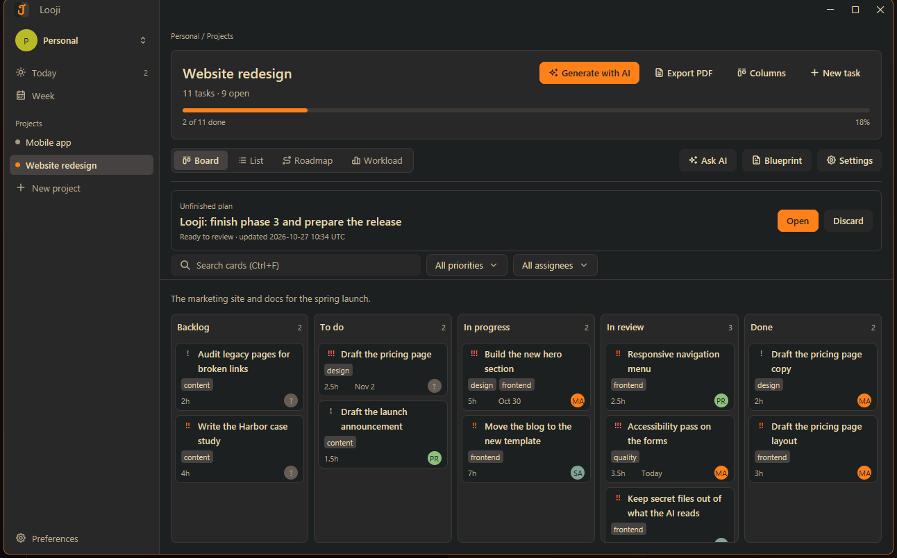
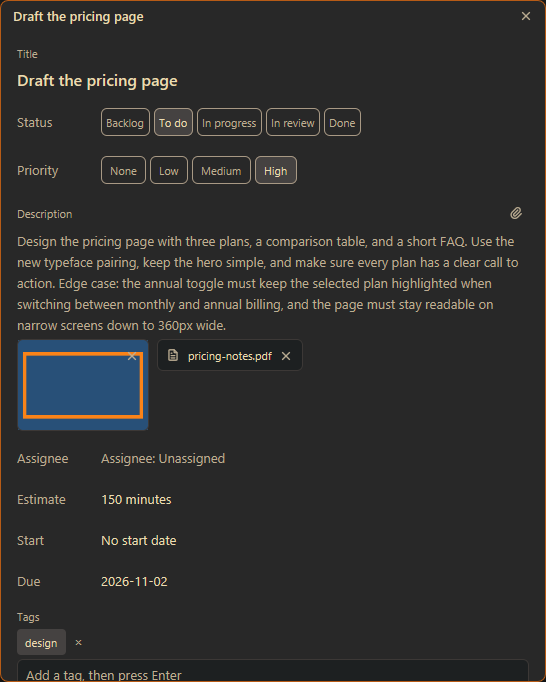
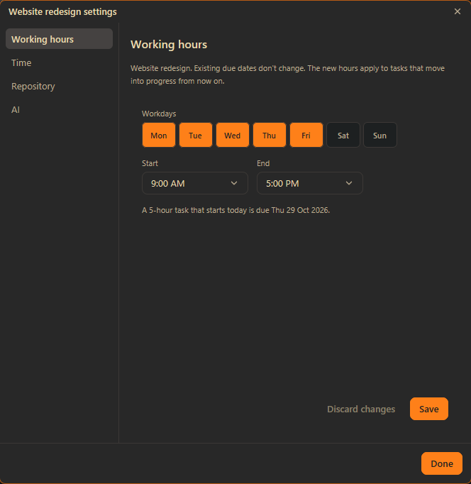
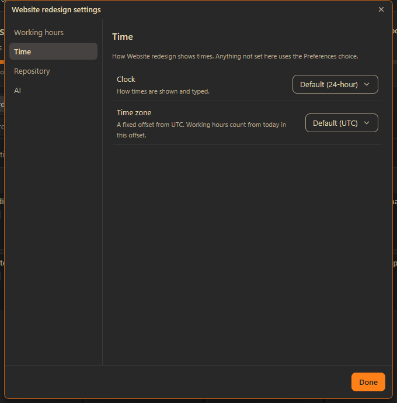
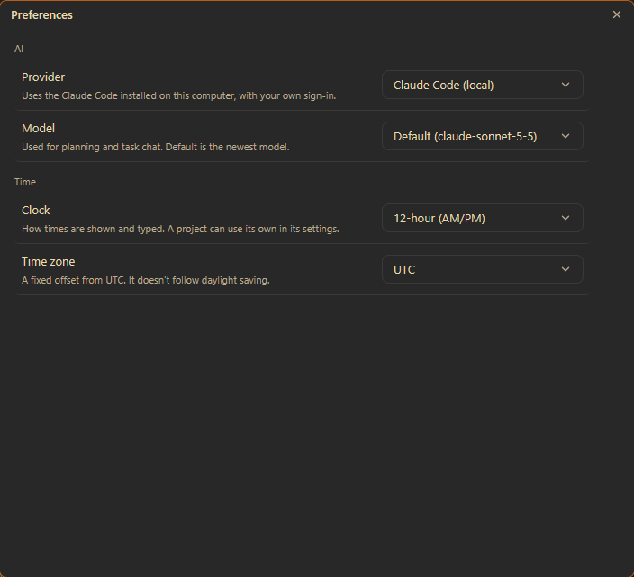

<p align="center">
  
</p>

<h1 align="center">looji</h1>

<p align="center">
  <strong>A desktop board for planning and tracking work, with AI planning, task chat, repository awareness, and PDF reports.</strong>
</p>

<p align="center">
  <a href="https://github.com/loojihq/looji/actions/workflows/ci.yml"></a>
  <a href="https://github.com/loojihq/looji/releases/latest"></a>
  
  
  
</p>

looji keeps your workspaces, projects, and tasks on boards you can drag around. It can draft a project plan with AI, chat
about a single task with the code it touches, and export a project as a PDF. Everything is stored in one folder on your
computer.



## Features

- **Boards, lists, and timelines.** Drag cards between columns and reorder them. A project can also be seen as a list, a
  roadmap, or a per-person workload. The sidebar has **Today** and **Week** screens too.
- **Working hours.** Each project sets its workdays and daily hours. Due dates count working hours, and the settings
  preview when a sample task would be due.
- **Your clock.** Show times on a 24-hour or 12-hour (AM/PM) clock, and on a fixed UTC offset. Set them once in
  Preferences, or change them for a single project.
- **Planning with AI.** Describe a goal and get a plan of sections and tasks, each with a priority and an estimate. You
  review and edit the plan before anything is added to the board. An unfinished plan is kept for its project until you
  open it again or discard it.
- **Chat with repository context.** Link a project to a git repository, and a task's chat can read the code that
  matches it. **Ask AI** in the project header chats about the whole codebase, and the conversation is kept with the
  project.
- **Team and assignees.** Add people to a workspace, assign them to tasks, and filter the board by assignee.
- **Reports.** Export a project as a PDF with a cover, a count for each status, and every task grouped by status.
- **Light and dark.** looji follows the Windows light or dark setting.
- **Safe updates.** New versions are downloaded, checked against the SHA-256 checksum published with the release, and
  installed in one click. Your database is backed up before an upgrade changes it.

## Screenshots

<table>
  <tr>
    <td width="50%"></td>
    <td width="50%"></td>
  </tr>
  <tr>
    <td width="50%"></td>
    <td width="50%"></td>
  </tr>
</table>

## Get started

New here? Read the [user guide](docs/user-guide.md). It starts with a first task you can finish in a few minutes.

## Install

Download `looji-<version>-windows-x64-setup.exe` from the [latest release](https://github.com/loojihq/looji/releases/latest)
and run it. It installs for your own account and doesn't need administrator rights.

Releases are not yet code-signed, so Windows may show an "unknown publisher" warning. Choose **More info**, then **Run
anyway**. Each release includes a `SHA256SUMS.txt` so you can check your download.

The release workflow also builds Linux packages (`.deb`, `.rpm`, and an Arch package). The interface is developed and
tested on Windows.

## AI providers

Planning and task chat use one of two providers, chosen in **Preferences** and optionally per project in **Settings**:

- **Claude Code (local)** uses the Claude Code install on your computer, with your own sign-in. This is the default.
- **Anthropic API** uses an API key that you paste into **Preferences**. looji keeps the key in the Windows key store.

Plan and chat requests go only to the provider you chose. The update check is the one other network request, and it goes to GitHub.

## Development

Requirements: Windows 10 or 11, and a recent stable Rust toolchain.

```
cargo run --bin looji                              # run a debug build
cargo test --workspace                             # run the test suite
cargo clippy --workspace --all-targets -- -D warnings
cargo fmt --all -- --check
```

CI runs the last three on Windows and lints and tests on Linux. See [`ci.yml`](.github/workflows/ci.yml).

### Architecture

looji is a Cargo workspace. The rules live apart from the interface, so they can be tested without a window or a database.

| Crate | Responsibility |
| --- | --- |
| [`looji-domain`](crates/domain) | Types and rules: tasks, projects, working hours, clocks, and plans. No GPUI or SQLite. |
| [`looji-persistence`](crates/persistence) | The SQLite store, migrations, pre-upgrade backups, and the repository index cache. |
| [`looji-symbols`](crates/symbols) | Reads functions, types, and modules from source files with tree-sitter. |
| [`looji-ai`](crates/ai) | The provider-agnostic AI client, planning, and task chat and review notes. |
| [`looji-report`](crates/report) | Lays out a project report and writes it as a PDF. |
| [`looji-updates`](crates/updates) | Checks for a new release, downloads it, verifies it, and replaces the program. |
| [`looji-ui`](crates/ui) | The GPUI interface and the `looji` program. |

### Development switches

Debug builds read these environment variables, so features can be checked without a real account or a real release.

| Variable | Effect |
| --- | --- |
| `LOOJI_DATA_DIR` | Use this folder for the database and icons instead of `%APPDATA%\looji`. |
| `LOOJI_FAKE_AI=1` | Answer chat with a scripted provider. A message containing `slow`, `fail`, or `markdown` gets a long, broken, or markdown reply. |
| `LOOJI_UPDATE_URL` | Ask this address for the latest release instead of GitHub. |
| `LOOJI_UPDATE_NOW=1` | Skip the once-a-day schedule for the update check. |
| `LOOJI_FPS=1` | Draw continuously and log frames per second. Works in any build. |

### Branding

[`assets/branding/app-icon.svg`](assets/branding/app-icon.svg) is the source of the app icon. The other icon files are made
from it:

| File | Used by |
| --- | --- |
| `assets/branding/app-icon.ico` | The `looji.exe` icon (embedded by [`crates/ui/build.rs`](crates/ui/build.rs)) and the installer. |
| `assets/branding/app-icon-512.png` | The Linux packages, as the desktop icon. |
| `crates/ui/assets/app-icon-96.png` | The logo at the start of the title bar. |

## Releasing

1. Set the version in `Cargo.toml` under `[workspace.package]`.
2. Tag it and push the tag: `git tag v0.2.0 && git push origin v0.2.0`.

[`release.yml`](.github/workflows/release.yml) builds the program and the installer, signs them if a certificate is
configured, writes `SHA256SUMS.txt`, and publishes the release. Signing uses two repository secrets:
`WINDOWS_SIGNING_CERT_BASE64` (a base64-encoded `.pfx`) and `WINDOWS_SIGNING_CERT_PASSWORD`. Without them the release is
published unsigned, and its run summary says so. To rehearse without publishing, run the workflow by hand with **dry run**
turned on.

## Documentation

- [User guide](docs/user-guide.md): the board, planning, chat, repositories, reports, updates, your data, and troubleshooting.
